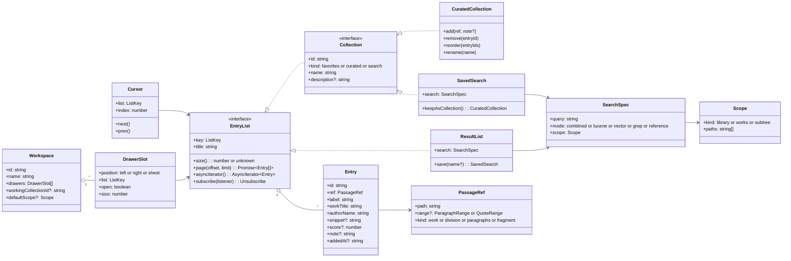

# Biblioteca Reader

Textbase Reader is the browser UI for the TEI corpus exposed by `textbase-server`. 
It keeps the existing discovery, scholarly reader, collections, search, admin, and payment designs while presenting live server records first and the original demonstration corpus afterward for comparison.

## Run locally

Requirements: Node.js 20+ and a running `biblioteca-server`.

```bash
rake npminstall
rake run            # dev profile: http://localhost:3333
```

The rake tasks load `biblioteca/dev` from the pass store through its own
`load-env.sh` - the same mechanism as biblioteca-server and
biblioteca-nestjs - so the reader fronts the `BIBLIOTECA_EXTERNAL_URL`
that stage advertises, and `GOOGLE_OAUTH_CLIENT_ID` is mapped automatically
to the build-time `VITE_GOOGLE_CLIENT_ID` (it must equal the server's own
`google.oauth.client-id`). `.env.example` documents the variables with
dummy values only; there are no `.env` files to copy. The reader listens
on <http://localhost:3333> (set `PORT` to change it) and expects the
server per `BIBLIOTECA_EXTERNAL_URL` (localhost:8080 when run bare).
Stripe is intentionally unconfigured for now: the `STRIPE_*` variables are
simply not provided anywhere and every payment feature reports itself
unconfigured.
Cover rendering is optional and defaults to `http://localhost:3335`; set
`COVERS_API_URL` only when the covers service lives elsewhere. The browser
still calls only `/api/covers/work` on this reader origin.
When `MINIO_URL` and `MINIO_CREDS` are present, the reader caches generated PNGs
under `covers/works/<authorId>/<opusId>-<identity-hash>.png` in the configured
the bucket named in `MINIO_URL`. A cache hit avoids invoking
the headless cover renderer. The browser still receives the image through the
reader's same-origin route; MinIO credentials never leave the server. New
cover jobs are owned by biblioteca-nestjs and use `covers/` directly; the
bucket may be anonymous/public-readable, but it must not be publicly writable.

Work cards show one fallback cover, `DefaultWorkCover` (the brush-paper
`cover-blue.jpg` with the title and author), both when the server has no
generated `coverUrl` and when a cover URL fails to load (`WorkCoverImage`). Cover generation is performed
asynchronously by `biblioteca-nestjs` after opus import/reimport; the reader
does not call the covers renderer directly.

Safe example values (never real credentials):

```dotenv
MINIO_URL=http://srv2.local:20124/biblioteca
MINIO_CREDS=example-cover-cache-access-key:example-cover-cache-secret-key
```

The URL includes the bucket and is the server-side MinIO API endpoint. The
credential is `access-key:secret-key`; it belongs to a restricted writer
account and stays in the pass store, never reaching the browser.

#### Development cover-cache MinIO setup

The development integration MinIO instance is the general-purpose MinIO
started by `scripts/docker/integration-deps/run-mini.sh` (not Milvus's
separate MinIO). Create a dedicated writer account and restrict it to the
cover prefix. The exact commands below use the MinIO Client (`mcli` here to
avoid colliding with Midnight Commander):

```bash
mcli alias set int-minio http://mini.local:20104 <root-user> <root-password>
mcli mb --ignore-existing int-minio/biblioteca
mcli anonymous set download int-minio/biblioteca
mcli admin policy create int-minio biblioteca-covers-writer ./biblioteca-covers-policy.json
mcli admin user add int-minio biblioteca-covers <generated-password>
mcli admin policy attach int-minio biblioteca-covers-writer --user biblioteca-covers
mcli admin user svcacct add int-minio biblioteca-covers
```

The writer policy should allow `s3:ListBucket` only for `covers/*`, and
`s3:GetObject`/`s3:PutObject` only for
`arn:aws:s3:::biblioteca/covers/*`. Store the generated access key and secret
as `MINIO_CREDS` under the appropriate `biblioteca/<profile>` pass-store
directory. Do not commit the credential or put a real value in `.env.example`.

## Architecture

### Browser networking boundary (mandatory)

The browser UI talks **only to this reader's own same-origin server**. React
components must use relative `/api/...` URLs (including
`/api/server-content/...` for raw book content) and must never call
`biblioteca-server`, `biblioteca-nestjs`, `biblioteca-covers`, MinIO, or any
other upstream host directly. `server.ts` is the single server-side gateway:
it owns the upstream URLs, authentication/cookie forwarding, allowlists,
timeouts, error translation, and same-origin response shape. Any new browser
data need therefore requires a narrow route in `server.ts`, documentation in
the reader OpenAPI contract, and regeneration with `rake gen-serverside-client`; do not
expose an upstream client or URL to the UI as a shortcut.

```text
React components
      |
readerService (online-first page requests; transient UI state only)
      |
generated OpenAPI client ---- canonical .txt/.json/.xml/.xhtml exports
      |                                      |
same-origin /api gateway in server.ts --------+
      |
textbase-server (unchanged)
```

- `server.ts` exposes a read-only `/api/server-content/*` proxy for raw book content. This avoids browser CORS differences while preserving all `biblioteca-server` routes, status codes, media types, and server-side decisions.
- The browser UI must call only this reader's same-origin server API. For example, work-cover rendering is `POST /api/covers/work`; `server.ts` adds the randomized cover theme and talks to `biblioteca-covers` privately. React code must never call biblioteca-server, biblioteca-nestjs, or biblioteca-covers directly.
- `openapi/reader-api.json` is the exported server contract (this app's own `/api/docs`, synced by `rake gen-serverside-client`). `openapi-typescript` generates `src/generated/same-origin-api.d.ts`, and `openapi-fetch` makes typed requests from `src/services/serversideApi.ts`.
- `readerService` requests only the visible author/work page from the live API; it does not persist or preload a full catalogue. Author works and chapter content are fetched on demand.
- Catalogue pages, author lists, repositories, and search results are live server data. Do not reintroduce a persistent full-catalogue cache: this UI is intentionally online-first so newly imported works appear without waiting for a cache refresh.
- Live chapter IDs are their full server paths. This preserves nested TEI divisions and bookmarkable reader links rather than inventing or flattening fragments.
- The four reader tabs use the server's canonical `.txt`, `.json`, `.xml`, and `.xhtml` representations.

### Refresh the API clients

`rake gen-client` regenerates the three upstream service clients from the
running sibling services. The profile is picked like every
other rake task: argument first, then the `PROFILE` env var, then the
machine's hostname.

- `gen-biblioteca-client` regenerates `src/generated/biblioteca-server-api.d.ts`
  — a typed client of biblioteca-server's raw spec
  (`${BIBLIOTECA_EXTERNAL_URL}/api/docs`), the same shape as
  biblioteca-nestjs's own `rake gen-client`. Nothing imports it yet; it
  exists so a direct server-side call can be typed against the real DTOs.
- `gen-serverside-client` regenerates `src/generated/same-origin-api.d.ts` —
  the client `serversideApi.ts` is typed against, describing THIS app's own
  server-side express API (served at `/api/docs`, Swagger UI at `/api/ui`) —
  via the allowlist pipeline (`npm run openapi:update`): shapes from the
  running biblioteca-server (`BIBLIOTECA_SERVER_URL`, default
  localhost:8080), the route list synced from this app's own dev server,
  then `openapi-typescript`. Start the dev server first (`rake run`,
  default localhost:3333) and after the latest `openapi:public:build`,
  since server.ts imports openapi-public.json at startup — a reader booted
  before the rebuild serves the previous document and the sync
  round-trips it.
- `gen-vectorizer-client` regenerates `src/generated/biblioteca-nestjs-api.d.ts`
  from the running biblioteca-nestjs vectorizer's live document
  (`NESTJS_URL/api/ui-json`, default localhost:3334). Its raw spec is used
  directly — the vectorizer's admin surface has no allowlist/proxy layer.
- `gen-cover-api` regenerates `src/generated/biblioteca-covers-api.d.ts`
  from `COVERS_API_URL/api/docs` (default `http://localhost:3335`). This
  client is for server-side integrations; browser code still uses only the
  reader's same-origin `/api/covers/work` route.

The biblioteca-server and vectorizer spec jsons are downloaded transiently
and removed after generation; the generated `.d.ts` files are checked in.
Commit them so API drift is reviewable.

##### Running the regeneration, end to end

All four sibling clients are generated off **running** servers, so a full
`rake gen-client` needs biblioteca-server, biblioteca-nestjs, and
biblioteca-covers up — and running the repo's current
code, not whatever the deployed containers happen to be:

```bash
# 1. biblioteca-server, on :8080 (rake run picks the pass-store profile by
#    hostname; bootRun binds 8080):
cd ../biblioteca-server && rake run
# 2. biblioteca-nestjs, on :3000:
cd ../biblioteca-nestjs && rake run
# 3. this app's own dev server, on :3333 by default (PORT/READER_URL to
#    override; the default port can be busy on dev machines):
cd ../biblioteca-reader && rake run          # or: PORT=3334 npm run dev
# 4. then, from this repo:
rake gen-client                               # regenerates the three upstream clients
```

Two traps, both hit in practice:

- **Generate off repo HEAD, not the deployed containers.** The deployed
  biblioteca-server image can lag the repo (e.g. a renamed endpoint
  exists in HEAD but not in the running container) — the generator fails
  loudly on a missing allowlisted path, which is exactly the design, but
  the fix is running the repo's server locally, not loosening the
  allowlist.
- **`gen-serverside-client` is a round trip through this app's own
  running server**: `openapi:public:build` writes `openapi-public.json`,
  but `server.ts` imports that file **at startup**, so a reader booted
  before the rebuild serves the previous document and the sync step
  copies it straight back — a silent no-op. After changing anything in
  the allowlist/`openapi-public.json`, rebuild first, *then* restart the
  dev server, *then* run `openapi:sync` + `openapi:generate` (or just the
  full `rake gen-serverside-client` again once the server is new).

#### Which client may be used where (important for coding agents)

The browser UI talks **only** to this app's own server-side API. The other
two clients exist for the server-side component (`server.ts`) to relay
through — importing them into browser code is wrong even when the types
happen to fit: it bypasses the reviewed public contract (and the
`/api/**` gateway's proxying, auth, and same-origin behavior) and couples
the UI to upstream surfaces this app deliberately does not expose.

| Client | Browser UI (`src/` React code) | Server side (`server.ts`) |
| --- | --- | --- |
| `same-origin-api.d.ts` (this app's own API, via `serversideApi.ts`) | **yes — the only one** | yes |
| `biblioteca-server-api.d.ts` (biblioteca-server raw) | **never** | yes — relay/proxy calls |
| `biblioteca-nestjs-api.d.ts` (biblioteca-nestjs) | **never** | yes — relay/proxy calls |

Rule of thumb: a new browser-side data need means adding a route to
`server.ts` (and to the allowlist in `scripts/build-openapi-public.mjs`),
then `rake gen-serverside-client` — not importing an upstream client into the UI.

## Spec: quoting a paragraph, editing, and a text-only twin of every URL

Status: **specification only, nothing here is implemented yet.** Goal: let a
reader share a quote of a single paragraph (or any block) with as little
machinery as possible, while the reading page stays what it is today: plain
text on paper.

### 1. Paragraph quoting and editing

**Implemented on 2026-10-14:** hovering a reading block for 400 ms reveals a
clickable, translucent gray ¶ button inside the block’s top-left corner and highlight; a stationary touch/pen press for 500 ms
also selects the block and opens the existing quote/copy/save/citation toolbar.
`q` opens actions for the active block; `Esc` dismisses them. Moving a finger,
scrolling, cancellation, and quick taps do not activate it. Links, footnotes,
and editable controls retain their own gestures. The marker is rendered outside
the imported chapter HTML so it is never included in copied/quoted text.

The stable block URLs, correction editing, and crawler text twin below remain
proposed work; the current implementation reuses the existing quotation actions.


#### 1.1 Is a separate mode needed? No: recommended design is modeless

The request was a `q` "quote/edit mode" in the navbar that decorates every
block. The same result is available **without a mode and without decorating
anything**, so the recommendation is to skip the mode:

- **Read mode stays undecorated.** No per-paragraph buttons, no wrappers, no
  extra DOM, no listeners per paragraph. The chapter HTML
  (`chapter.htmlContent`, injected once with `dangerouslySetInnerHTML`) is not
  touched.
- **One delegated listener** on the existing `contentRef` container handles
  everything (`pointerup`/`click`, resolved with `event.target.closest(BLOCKS)`
  where `BLOCKS = 'p, h1, h2, h3, h4, h5, h6, blockquote, li, .l, .lg'`). There
  is no cost until the user acts.
- **A tap/click on a block is not enough to trigger anything** (it would
  fight with scrolling, links, footnote taps and the text selection). The
  trigger is explicit and cheap:
  - **Desktop:** hovering a block for ~400 ms shows a small `¶` glyph in the
    left margin only (CSS `::before` on a single `.block-active` class added
    to the one hovered block, removed on leave). Clicking the `¶`, or pressing
    `q` while a block is hovered/focused, opens the *block popover*.
  - **Mobile:** a **long-press** (500 ms) on a block, which is a gesture that
    selects text natively, opens the same popover. No hover exists; nothing is
    drawn until the long-press.
  - **Keyboard:** `q` opens the popover for the block under the pointer or the
    one holding the caret; `Esc` closes it.
- **The block popover** (the one new component, `BlockQuotePopover.tsx`,
  mounted once, positioned next to the active block, same visual family as
  the existing `#selection-quote-toolbar`): highlights the block (outline
  via the `.block-active` class), and shows

  | Control | Result |
  |---|---|
  | Stable URL | read-only input with the link, plus **Copy link** |
  | Human form | e.g. `Biblia, Gen 2.4` / `Hamlet, III.1.56`, plus **Copy citation** |
  | Copy HTML | copies the block's `outerHTML` |
  | Edit | (§1.4) |

  Closing: `Esc`, a click outside, or opening another block.

If a mode is still wanted later, it is just "always show the `¶` glyphs": a
navbar toggle (and `q` outside a block) that sets one class on the container.
It would add no other behavior, so it is optional and should not be built first.

#### 1.2 Stable block address

Blocks need an identity that survives re-renders and is the same for everyone.

- The server's TEI-to-HTML output currently emits **no ids on `<p>`**
  (checked on `sagarra/paulina`). Two options, in order of preference:
  1. **Server stamps ids** at HTML generation: `id="p<N>"` where N is the
     1-based ordinal of the block within its div (a div being the unit
     addressed by `authorId/opusId/div1/div2...`). Ordinal-within-div is
     stable as long as the text is not re-imported with different paragraph
     breaks; where TEI already has `xml:id`, use that instead. Verse lines
     keep `l@n` as `v<n>`.
  2. **Reader computes it** on demand when the popover opens (index of the
     block among `BLOCKS` in the container). Needs no server change, but drifts
     if the server HTML changes. Acceptable as a first cut, since it is only
     evaluated on user action.
- **URL form:** the canonical address of a block is the **work-relative path
  plus a fragment**: `/app/reader/{authorId}/{opusId}/{div1}/{div2}#p17`
  (reader) and `/{authorId}/{opusId}/{div1}/{div2}#p17` (text twin, §2).
  Per the project rule, the work is always identified by `authorId/opusId`,
  never by a database id. A range is `#p17-p19`. `buildAppPath` and
  `parseAppPath` gain an optional `block` field; on load the reader scrolls to
  it and applies `.block-active` once.
- **Relation to existing quotes:** `/app/quote/{uuid}` (arbitrary text
  selection, character offsets) stays as is and keeps using the existing
  selection toolbar. Block links are the cheap special case that needs no
  stored object and no server round trip. The selection toolbar may also show
  the **human form** for a selection (`Biblia, Gen 2.4`) using the same helper.
- Fragments are never sent to a server, which is why the block link
  needs no server support in the reader and is trivially cacheable.
  Crawlers ignore it, so §2 may additionally take `?p=17` (see there).

#### 1.3 Human-readable citation (any work, not just the Bible)

A pure function `formatCitation({ work, chapterPath, block })`:

- Takes the work's short title (from the opus metadata; a per-work
  `citationAbbrev` override later, e.g. `Biblia` / `Gen`), the div trail as
  numbers where the divs are numbered (`2`, `III.1`) or heads otherwise, and
  the block ordinal or verse number.
- Defaults: `Title, <div-trail>.<block>` -> `Hamlet, 3.1.56`; for works whose
  div-1 is a book with numbered chapters and verse blocks (the Bible) the
  abbreviation comes from the opus metadata -> `Biblia, Gen 2.4`.
- No per-work special cases in code. Anything unusual belongs in metadata.

#### 1.4 Edit (suggest a correction)

- **Edit** sets `contenteditable="true"` on **that one block element only** and
  focuses it, and docks two buttons (Submit / Cancel) in the popover. Cancel
  restores the saved `innerHTML`.
- **Submit** calls `POST /api/edits` (same origin; add to `server.ts` and to
  the allowlist of `scripts/build-openapi-public.mjs`, then
  `rake gen-serverside-client`; never a direct upstream call, see "Browser
  networking boundary"). Body:

  ```json
  { "path": "authorId/opusId/div1/div2", "block": "p17",
    "originalHtml": "...", "editedHtml": "..." }
  ```

  The reader relays it to biblioteca-server (`relayBodyToBiblioteca('POST')`
  as `/api/collections/mine/searches` does).
- **biblioteca-server** validates the shape, **logs the edit** (path, block,
  user id if signed in, sizes; never the secrets), and answers
  **`501 Not Implemented`** with `{ "error": "edits are not implemented yet" }`.
  Nothing is stored.
- The reader shows the status in the existing toast (the one used by
  `ServerStatusToast`): `Edits are not available yet (501)`. The
  block keeps the user's text on screen until they cancel or reload, so
  nothing the user typed is lost.
- Sanitization is a server concern when the endpoint is implemented. The
  reader never trusts or injects edited HTML into other users' pages.
- Scope guard: only offered on blocks inside the chapter container,
  never on the navbar, the footnote sheet or generated chrome.

#### 1.5 Files touched (estimate)

`src/components/BlockQuotePopover.tsx` (new), a delegated handler hook
`useBlockQuote.ts` (new), `ReaderView.tsx` (mount + hook), `router.ts`
(`block` in `RouteState`, `buildAppPath`, `parseAppPath`), `src/index.css`
(one `.block-active` rule), `src/services/citation.ts` (new, tested),
`server.ts` + openapi script (the `/api/edits` relay), and in biblioteca-server one controller
returning 501 plus a log line. About 300 lines in total, nothing on the render
path of an unselected page.

#### 1.6 Tests

- `citation.test.ts`: Bible, a play, a prose work with only heads.
- `router.test`: round trip of `#p17` and `#p17-p19`.
- `BlockQuotePopover` renders URL + citation for a given block; Esc closes.
- A delegated-handler test: click on a link or footnote inside a block does
  not open the popover.
- Server: `POST /api/edits` returns 501 and logs once.

### 2. The same URL for lynx, curl and social crawlers

#### 2.1 What already exists

- **biblioteca-server already serves plain HTML at the root**
  (`/{authorId}/{opusId}/{div1}/...`, `DivController`). That is already a
  server-rendered, no-JavaScript text edition: `curl localhost:8080/sagarra/paulina`
  returns a full page with `<h1>`, the `<p>` text, a TOC and prev/next links.
  Lynx can read it today.
- **The reader already does crawler SEO for its own routes** (`src/seo.ts`):
  `server.ts` serves `index.html` for every route, with `og:*`, `canonical`
  and JSON-LD filled by `buildPageSeo` + `renderIndexHtml`, because social
  crawlers (Facebook, Slack, X, iMessage) never run the bundle.
- What is **missing**: (a) a reader URL (`/app/reader/...`) shows lynx/curl an
  empty SPA shell (only meta tags, no text); (b) the server's own HTML has
  weak or broken metadata (`og:url` is `.`, `og:description` is empty, the
  `og:image` is a hotlinked third party image, page not-found for unknown
  paths says `noindex`, which is right); (c) the two URL spaces differ, so one
  shared link cannot serve both audiences.

#### 2.2 Recommendation: one URL, content negotiation by capability

"Two versions of one site on the same URL" is a well-known, legitimate
pattern (progressive enhancement / dynamic rendering) **provided both
versions have the same text**. Search engines treat different content shown
only to bots as cloaking; here the bot version is the same text without the
JavaScript, which is allowed.

Rule at the edge (`server.ts` `app.get('*')` or Caddy, whichever sees the
request first), for a reader content URL:

1. **Humans in browsers:** `Accept` contains `text/html` **and** the client is
   a modern browser (has `Sec-Fetch-Mode: navigate`, or a normal browser UA
   not on the bot list) -> serve the SPA shell exactly as today.
2. **Everything else** (curl with no `Accept`, lynx/w3m/links, text-only UA,
   known crawler UAs such as `facebookexternalhit`, `Twitterbot`, `Slackbot`,
   `Googlebot`, `WhatsApp`, `TelegramBot`, `Discordbot`, `LinkedInBot`) ->
   serve the **text twin**: the server-rendered chapter HTML, with the
   `<meta og:*>` set for that page, no scripts.
3. **Explicit overrides** (so nothing depends on sniffing):
   `?view=text` forces the twin, `Accept: text/plain` returns plain text,
   `Accept: text/markdown` returns Markdown, `Accept: application/json`
   returns the page as JSON (this is already the shape of
   `GET /api/divs?path=`). `Vary: Accept, User-Agent` is set on all of them so
   caches never mix versions.

Sniffing is a convenience for crawlers, never the only path: the explicit
`?view=text` link and a "Plain text version" `<link rel="alternate">` in
the SPA shell keep it discoverable and testable.

#### 2.3 Where the twin comes from (cheapest first)

1. **Reuse biblioteca-server's `DivController` HTML** and proxy it: the reader
   asks `GET /{authorId}/{opusId}/{divs}` upstream (already exists, already
   escaped, already complete) and returns it for twin requests, after
   rewriting links from `/{path}` to the public reader form, and filling
   `og:*` / `canonical` through the existing `buildPageSeo`. No new
   renderer to maintain. This is the recommended first step.
2. **A tiny reader-side renderer** from `GET /api/divs?path=` JSON to
   minimal HTML (title, blocks with their `id="pN"`, prev/next). Better
   control over the markup (and over what social cards quote), at the
   price of a second renderer. Only if (1) proves too noisy.
3. The SPA with prerendering for every work is **not recommended**: ~3,800
   works x chapters, no benefit over (1) or (2).

#### 2.4 Block links on social platforms

A crawler never sends a `#fragment`, so `#p17` alone can't give a card the
paragraph. Add the equivalent **query form** `?p=17` (and `?p=17-19`), accepted
anywhere `#p17` is. The twin then:

- puts the quoted block(s) in `og:description` (trimmed to ~200 characters),
- sets `og:title` to the citation (`Biblia, Gen 2.4`),
- sets `canonical` to the **chapter** URL (so the paragraph variants don't
  split ranking) and `og:url` to the URL actually shared,
- reuses the work cover for `og:image` (`/api/covers/work/:authorId/:opusId`,
  already a stable GET), fixing the hotlinked image of the server pages.

The popover's "Copy link" therefore copies `...?p=17#p17`: the query serves
crawlers, the fragment scrolls browsers. A browser opening it scrolls to and
highlights the block; lynx/curl get the twin with that block first.

#### 2.5 What breaks or needs care

- **Cloaking risk:** the twin and SPA must carry the same text. A test fetches
  a chapter both ways and compares the plain text.
- **Paywalled / premium works** (`access` filter in the catalog): the twin must
  apply the same rule, showing only the free preview that the SPA would show
  an anonymous visitor.
- **Size:** very long chapters. The twin may paginate or truncate at a
  documented limit, with `rel="next"` links. Crawlers have size caps.
- **Two URL spaces:** `/app/reader/...` (reader) and `/{author}/{opus}/...`
  (server) both exist. Decide one public form (reader's, with Caddy proxying
  twin requests to the reader). Redirect the other with a `301`, or serve it
  as the twin with `canonical` pointing to the reader URL. Prod Caddy
  must route `/app/*` to the reader (not yet verified, as noted in the project
  status).
- **robots.txt and sitemap** list the canonical form only.
- Legacy `og:url` `.` and empty `og:description` in `DivController` pages are
  bugs to fix regardless of this spec.

#### 2.6 Suggested order

1. Server: stamp block ids (`pN`) in generated HTML; fix `og:*` of `DivController`.
2. Reader: `formatCitation`, `block` in the router, `BlockQuotePopover`
   (copy link/citation/HTML). This alone delivers "share a single paragraph".
3. Reader + server: `POST /api/edits` -> 501 with the toast.
4. Reader: twin negotiation (proxy of the server HTML, `?view=text`, `?p=`)
   and the crawler tests (curl, lynx, and a `facebookexternalhit` UA fixture).

## Covers and future default illustrations

When an author thumbnail is present, the reader uses it through the same-origin proxy. Otherwise it chooses a deterministic stock book image, so the same work keeps the same fallback cover.

A proper default-illustration feature belongs in Textbase metadata rather than being silently generated by the reader. A future server-side pipeline can generate an illustration from title, author, language, period, and optionally a synopsis; store the image URL plus provider/model, prompt, license, creation time, and review status; and expose those fields in the OpenAPI work DTO. The reader adapter can then prefer a reviewed generated illustration, followed by an author image and finally the current stock fallback. This makes inexpensive AI image services easy to add without losing provenance or editorial control.

## Verification

```bash
npm test
npm run lint
npm run build
```

The tests certify language/cover mapping and that the checked-in OpenAPI export contains every endpoint used by the reader integration.


## Cover thumbnails through the reader gateway

Stored cover URLs remain original URLs in catalogue data. Display components
request same-origin WebP thumbnails from `/api/cover-thumbnails?url=...&width=320`.
Cards use 320 pixels, the main work cover 640, and checkout previews 160. Existing
local/data-image defaults pass through unchanged; a thumbnail load failure uses
the existing local fallback. Old locally cached work metadata is also handled
by the cover component. Cover downloads/rendering and stored originals are untouched.

The gateway forwards only thumbnail GET requests to `COVERS_API_URL`, including
`/api/cover-thumbnails/cache/<key>` for cached images. It preserves ETag,
Cache-Control and hit/miss headers and rewrites Content-Location to same origin.
It never forwards browser cookies/Authorization or exposes cache deletion.
The routes appear in `/api/docs` and have their own
`/api/cover-thumbnails/openapi.json` document.

The covers service must run its new `src2/` API and allow the original MinIO
origin through `THUMBNAIL_SOURCE_ORIGINS` or its MinIO URL configuration. It
owns conversion and persistent disk caching; the reader has no second disk cache.
No new development server or Docker deployment was started for this change.

For bare-metal thumbnail development on zmeu, use
`rake 'run[zmeu,http://localhost:3335]'` to select the dev covers endpoint
explicitly after loading the pass-store profile. Omitting the second argument
keeps the configured profile endpoint.


## Same URL reader and text edition (feat/same-url)

Reading URLs follow biblioteca-server exactly: `/{authorId}/{opusId}/{div...}`.
The author page lives at `/{authorId}`. Application pages (catalog, work details,
search, collections, admin and settings) retain `/app/...`. Existing
`/app/reader/...` links redirect permanently to the corresponding root URL.
Root `.html`, `.txt`, `.xml`, `.json` and `/_binary/` requests relay the existing
server response. Browser service requests remain same-origin under `/api/`;
metadata and TOC access uses the generated biblioteca-server client internally.
Reserved infrastructure prefixes include `/api`, `/assets`, `/src`, `/css`,
`/img`, `/js`, `/image`, `/biblioteca`, `/webjars`, `/dav`, `/v2` and `/v3`.

Modern browser navigations receive the JavaScript application. Curl, Lynx and
known crawlers receive the existing server-rendered chapter HTML, rewritten to
root reader links, without scripts or event handlers. `?view=text` explicitly
selects that edition. `Accept: text/plain`, `text/markdown`, or `application/json`
selects an export of the same literary content. Every reader response varies on
`Accept`, `User-Agent` and `Sec-Fetch-Mode`; negotiated responses are private and
require cache revalidation. The SPA advertises its text alternate in its head.

Click a paragraph to select its text and open the standard selection toolbar. Paragraph
ordinals are chapter-local (`?p=17#p17`, ranges `?p=17-19#p17-19`), excluding
ornamental separators. Source IDs are retained. Ordinals can change if an edition
is re-imported with different paragraph breaks. Sharing ranges highlights them
in both editions, keeps the chapter canonical URL, and puts the passage in the
crawler's description. The Edit button currently reports HTTP 501 without saving.

The text twin is always anonymous: it does not forward account cookies. Premium
metadata limits it to the first leaf chapter and preceding title pages; TOC or
upstream failures fail closed. Current live metadata exposes free works only.
The HTML text edition rejects documents above 8 MiB rather than silently
truncating them; normal reader export routes remain available for large sources.

### Reverse proxy deployment

`test.scriptorium.ro` already forwards root paths to dev reader port 3333.
Production currently sends root paths to biblioteca-server and strips `/app`.
Before deploying this branch, update its Caddy site to send reading and author
paths, `/assets/*`, `/api/*`, `/robots.txt` and `/sitemap.xml` to reader port 9032,
and use `handle /app/*` (preserve the prefix) instead of `handle_path /app/*`.
Keep `/biblioteca` and `/image/*` MinIO routes and internal API restrictions.
A proposed route fragment is in `deployment/root-reader.caddy`; it is not applied
by this development change. No Docker deployment or Caddy reload is performed.

Validation: `rake test[zmeu]` covers modern browsers versus curl/Lynx/social
crawlers, explicit formats, missing paragraphs, source IDs and premium gating.
`npx playwright test e2e/same-url.spec.ts e2e/paragraph-actions.spec.ts` compares
real chapter paragraphs between browser and text editions and checks sharing.


Quotations use the same server URL in both editions:
`/quote/{chapterPath}?start={teiDotAddress}&end={teiDotAddress}`. `/api/quote`
GET resolves an existing quotation; POST maps a selected passage to source
paragraphs through the generated server client and returns its permanent URL.
New Quote Link actions use these TEI addresses and work in a fresh browser.
Source matching preserves UTF-16 character offsets, normalizes display
whitespace, and uses the selected block and its preceding text to disambiguate
repeated passages. An ambiguous or unmatched passage reports a clear error
instead of inventing an address. Previously stored browser-only quotations are
preserved; source-addressed quotations do not depend on that browser storage.


### Similar passages from the reader

Click a paragraph or select a text fragment to open the same selection toolbar.
The selected paragraph keeps its gray right-hand bar; there is no separate ¶ button.
Choose **Similar** to run a semantic vector search for that exact selected text.
Results appear in a modal with the work-card TOC design, eight results per page,
loading/empty/error states, retry, and links back to the matching divisions.
Arrow keys page within the modal; Escape closes it. **Save search** stores the
query, vector mode, and results from visited pages through the existing saved
search store (account storage when signed in, browser storage otherwise).

This is a very useful feature.


# Best Search UI in the world - Modelling collections, text iterables, table of contents

Status: **spec, ready for implementation in steps** (see
[Assessment and implementation plan](#assessment-and-implementation-plan) at the
end). The original notes this spec grew from are kept verbatim at the very end.

Goal: a reader can search the whole library or just the book in hand, keep
working through the results across page loads, park what matters in
collections with one tap, and arrange searches and collections beside the
reader. One vocabulary, one item model, and shared UI components cover all
of it.

## 1. What already exists

The spec builds on what is there; most of the data plumbing exists.

| Area | Today | Where |
|---|---|---|
| Search modes | `title`, `author`, `lucene`, `vector`, `grep`; a combined default (all indexed modes at once, tiered) | `SearchView.tsx`, `readerService.searchCombined` |
| Search scope | **None.** `/api/search/{lucene,vector,grep,divHeads}` take only `q` and `limit` | biblioteca-server `SearchRestController` |
| Saved searches | Name + query + mode + up to 100 hits. Account: server collections of kind `SEARCH`; anonymous: localStorage | `services/savedSearches.ts`, `POST /api/collections/mine/searches` |
| Curated collections + favorites | Items of type work/chapter/quote. **Stored inside the user-preferences JSON** (account or localStorage), not in the server's collection tables | `readerService.attachCollectionsStore`, `preferencesStore.ts` |
| Server collection model | `DivCollection` (kinds `FAVORITES`, `USER`, `SEARCH`) with ordered items of kind `DIV`, `FRAGMENT`, `SNIPPET`; CRUD, item add/remove, reorder (`PUT /mine/{id}/order`), GraphQL `myCollections` | biblioteca-server `DivCollectionRestController`, `V10__Collections_with_uuid_ids` |
| Client filtering | Accent-folded, all-words matching shared by the collections screen and the TOC filter; keyboard row model | `services/collectionSearch.ts` |
| Generic types | `Collection<Entry>` with `PersonalCollection` and `SavedSearch` | `types/textbase.ts` |
| Similar | Selection/paragraph → vector search modal, paged, savable | `ReaderSimilarityDialog.tsx` |
| Shortcuts | `/` opens search, `s` opens the collections quick-find, ↑↓/PgUp/PgDn/Enter in the navbar dropdown | `Navbar.tsx`, `useCollectionsShortcut.ts` |
| Mobile sheets | Drag-to-dismiss and swipe hooks, a footnote bottom sheet; `motion` is already a dependency | `hooks/useDragToDismiss.ts`, `FootnoteSheet.tsx` |

Two consequences shape the plan:

1. **Book-scoped search needs server work.** It cannot be done by filtering
   client-side: a top-100 library-wide result list filtered to one book is
   usually empty or wrong.
2. **Collections are persisted two different ways.** Saved searches use the
   server collection tables; curated collections ride in the preferences
   blob. Unifying them on `/api/collections` comes first, because
   everything else (working collection, drawers, workspaces) refers to
   collections by id.

## 2. Vocabulary

One set of terms in code, UI and docs.

| Term | Meaning |
|---|---|
| **Passage** | Anything addressable in the library: a work, a division (chapter, subchapter), a paragraph range, or a quoted fragment. Identified by a stable path plus an optional range. |
| **Entry** | A passage *inside a list*, with list-specific data: label, snippet, score, note, when added. Every list holds entries. |
| **List** | An ordered, iterable sequence of entries. Every list is iterable. |
| **Collection** | A named, persisted list. Kinds: **Favorites** (one per reader), **Curated** (hand-made), **Saved search** (a frozen result snapshot plus its query). |
| **Search** | Query + mode + scope. Running it produces a **result list** (transient, server-paged). |
| **Last search** | The most recent search and its results, cursor included. Always kept, survives reloads, reopened by `/`. Not a collection until saved. |
| **Search history** | The recent searches (query + mode + scope, no results), for quick re-run. |
| **Working collection** | The curated collection that "Add" targets by default: the last one used, or one the reader pinned. |
| **Scope** | Where a search looks: the whole library, a set of works, or a division subtree. Defaults from context. |
| **Cursor** | The current position in a list: "result 7 of 120". Lets the reader step to the next or previous entry while reading. |
| **Drawer** | A collapsible panel beside the reader showing one list. |
| **Workspace** | A named arrangement: which list sits in which drawer, plus the working collection and the default scope. Stored with the account. |

**Searching vs filtering.** *Searching* asks the server, produces a new
result list and is recorded in history. *Filtering* narrows a list that is
already loaded (a collection, the TOC, the current results), runs in the
browser, and is not recorded. Both use the same input component, made
visually distinct: a magnifier with "Search the library…" / "Search in
*Biblia ortodoxă*…" versus a funnel with "Filter 37 entries…". The UI never
switches silently from one to the other.

**Last search vs working collection** (open question in the notes): these are
two roles, not one. The last search is where you *read from*; the working
collection is where you *put things*. Both can be shown in drawers at the
same time. A saved search is a snapshot and does not accept manual adds;
**Keep as collection** turns it into a curated collection when the reader
wants to curate it.

## 3. Data model



Design rules:

- **One entry shape.** `Entry` replaces both `CollectionItem` and
  `SavedSearchItem` in the UI layer. Adapters map server items
  (`DIV`/`FRAGMENT`/`SNIPPET`) and legacy local items onto it. Every list
  component renders `Entry`s, so a result list, a collection and a saved
  search look and behave the same.
- **Iterable, but paged.** `EntryList` is an `AsyncIterable<Entry>` (the "all
  collections are iterables" requirement), and the UI uses `page(offset,
  limit)` so long result lists can be virtualized and fetched lazily. `size()`
  may be unknown for open-ended server searches.
- **`ListKey`** (`collection:<uuid>`, `search:last`, `search:<uuid>`) is what
  cursors, drawers and workspaces store. They never hold list contents.
- **`PassageRef.path`** is the stable author/opus/division path the router
  and the quote API already use. Paragraph ranges reuse `paragraphLinks.ts`
  (`p3-p7`); fragments reuse the TEI dot addresses of the quote API.
- The package lives in `src/library/` (`types.ts`, `adapters/`,
  `lists/`, `cursor.ts`, `scope.ts`) with no React imports, like
  `googleOneTapAuth.ts`. React hooks (`useList`, `useCursor`,
  `useWorkingCollection`) are thin wrappers using `useSyncExternalStore`
  around the existing subscribe pattern, so no state library is needed.

## 4. Search behaviour

### 4.1 Entry point: the search panel (non-modal)

- `/` (and the navbar icon) opens **one search panel**: centered on screen
  when nothing else is going on, as a drawer when a workspace has one, and as
  a full-height sheet on phones.
- It is **not a blocking modal**: on desktop, choosing a result opens it in
  the reader while the panel keeps its query, results and cursor. Reopening
  (`/` again) shows the same state *hydrated*: highlight on the entry last
  opened, scroll position kept. On phones the sheet closes on open, and `/`
  or the search tab restores it the same way.
- Editing the query after looking at a result simply continues the search.
  Nothing is lost.
- Keyboard: ↑ ↓ PgUp PgDn Home End move the highlight, Enter opens, Esc
  closes the panel (state kept). While reading a result: `]` / `[` open the
  next / previous entry of the **active list** (the last search by default;
  the list in the focused drawer otherwise). These are new bindings: `n`/`p`
  would clash with the reader's typing guard and existing letter shortcuts.

### 4.2 Scope

- Default scope comes from context: **library** in the catalog, **the current
  work** in the work page and the reader. A scope chip row under the input
  shows it ("In: *Biblia ortodoxă* ✕"); ✕ widens to the library.
- **+ Add work** puts other works in scope (typeahead over titles). A
  collection can be used as a scope ("search within the works of collection
  X"), so curated collections double as reusable search perimeters, e.g.
  "my three Bibles".
- Scope is part of `SearchSpec`. It is recorded in history and saved with a
  saved search.
- Server: `scope=<path>` (repeatable) on `/api/search/lucene`, `/grep`,
  `/divHeads` and `/vector`, meaning "path equals or starts with one of
  these". Lucene: a prefix query on the indexed path field. Vector store:
  a payload or metadata filter on the path. Grep: restrict the scanned
  divisions.

### 4.3 Modes

Combined (default), Lucene, Vector (semantic), Grep, and **Reference**
(below). Title and author lookups stay as **navigation suggestions** in the
dropdown (open a work or author page). They are not recorded in history or
saved. History is for text searches.

### 4.4 Reference search (Bible and other numbered texts)

- Typing a reference such as `1 Samuel 17`, `1 Sam 21:6`, `1 Regi 21`,
  `Mt 12:3-4` or `Luc 6, 3-4` is detected by a reference parser. The
  **first result** is "Go to 1 Samuel 17 in *Biblia ortodoxă*" (the Bible in
  scope or currently open), followed by the same passage in the other Bibles
  of the library. Enter jumps there, highlighting the verse paragraphs.
- Book names depend on language **and tradition**: the Romanian Orthodox
  Bible calls 1–2 Samuel "1–2 Regi" (Septuagint naming), so "1 Regi 21:6" there
  is 1 Samuel 21:6 elsewhere, and Psalm numbers differ between Hebrew and
  Septuagint numbering. The parser yields canonical OSIS ids (`1Sam.21.6`);
  a **per-edition reference index** maps OSIS book/chapter/verse to that
  edition's division path and paragraph.
- That index cannot be derived from paths: division slugs come from headings
  (`…/cartea_intai_a_regilor/nasterea_lui_samuel`). Chapters are marked in
  heading text (`<span class="head-label">Capitolul 1.</span>`, or `Chapitre 1`
  as a `div3` inside one `div2` per book in the French Bible). Verses are
  paragraphs starting with `1.` or `1 `. The index is built **server-side at
  import** with per-edition rules (book-heading → OSIS map, chapter-label
  regex, verse-prefix regex) and stored as a small table:
  `(work, osisBook, chapter, verse) → (divPath, paragraph)`.
- **Cite**: on a resolved reference or a verse selection, "Copy citation"
  gives `1 Sam 21:6 (Biblia ortodoxă)` with or without the text, plus the
  permanent quote URL.
- **Cross-references** for the "1 Sam 21:6 → Mt 12:3-4, Mk 2:25-26, Lk 6:3-4"
  use case: scoped Similar (vector search restricted to the New Testament of
  the open Bible) finds them semantically. A curated cross-reference dataset
  (OpenBible.info publishes a large one under a CC-BY licence; check the
  terms before use) would list them directly as a "Cross-references" entry
  in the selection toolbar.

### 4.5 History and last search

- Every executed text search records `SearchSpec + executedAt + resultCount`
  in **search history** (deduplicated by spec; most recent first; capped,
  e.g. 200). Shown under the empty search input; ↑ in an empty input recalls
  the previous query. Removable one by one; "Clear history".
- The **last search** stores its spec, the result pages fetched so far and its
  cursor. It survives reloads (IndexedDB via a tiny key-value wrapper;
  localStorage is too small for result pages) and is restored by `/`.
- Anonymous readers keep both in the browser. Signed-in readers: history is
  synced through the preferences store (small), and the last search stays
  per-device in the first version.

## 5. Collections

### 5.1 Adding: one tap

- The selection toolbar (where **Similar** lives) and the reader toolbar get
  **Add to ‹working collection›**: one tap adds the selection (as a
  fragment), the tapped paragraph range, or the current chapter. A chevron or
  long-press opens the chooser: recent collections first, filter-as-you-type,
  "New collection…" inline.
- The working collection is whatever was used last, unless pinned. It is
  shown in the button label so the target is never a surprise. A toast
  offers **Undo**.
- Search results get the same button on each row (replacing "Save Result").

### 5.2 Managing: the Collections page as a workspace manager

- One list of all collections (Favorites, Curated, Saved searches), with a
  search input at the top that **filters** by name, description and entry
  contents (the existing `buildCollectionsView` semantics).
- Inline create / rename / describe / delete; drag-and-drop and keyboard
  reorder of entries (server `PUT /mine/{id}/order` exists); move or copy
  entries between collections; per-entry note.
- Each collection offers **Open in drawer**, **Set as working collection**,
  **Search within its works** (scope) and, for saved searches, **Run again**
  and **Keep as collection**.
- The `s` quick-find (CollectionsModal) becomes a lightweight view of the
  same list component, not a second implementation.

## 6. Drawers and workspaces

- **Desktop:** the reader stays centered; a right drawer (and later a left
  one) hosts any list: the last search, a saved search, a curated
  collection. Drawers are resizable and collapsible to a thin rail, with
  their own filter input. A key toggles them (proposal: `\`), and they
  remember open/closed state and width.
- **Phone:** no side space, so drawers become one **bottom sheet** with snap
  points (peek / half / full) and tabs for the lists the workspace holds. The
  same list component renders inside. Principle: every desktop operation is
  possible on a phone, one drawer at a time.
- **Workspace:** the drawer arrangement plus the working collection and the
  default scope, stored with the account through the preferences store and
  switchable by name ("Bible study", "Hugo letters"). Version one has a single
  implicit workspace; named workspaces come later (step 8).
- Top and bottom drawers, tabs inside drawers, floating or detached panels:
  **not planned** (see the assessment).

## 7. Server work required

| Change | Needed by | Size |
|---|---|---|
| `scope` (path prefixes) on lucene, grep, divHeads, vector search | Step 4 | M: Lucene and grep straightforward; the vector store needs a path filter in the query |
| Curated collections and favorites served from `/api/collections` instead of the preferences blob, with a one-time migration of existing preference collections | Step 0 | M |
| `FRAGMENT` items carrying quote addresses and `DIV` items carrying paragraph ranges (fields exist: `fragmentStart`, `fragmentEnd`) | Step 3 | S |
| Search history in the preferences document (or its own small table if it grows) | Step 2 | S |
| Per-edition Bible reference index built at import | Step 7 | L |
| Workspace documents in the preferences store | Steps 6 and 8 | S |

## 8. Open-source building blocks

The stack today is React 19, Tailwind 4, `lucide-react` and `motion`, with no
component library. The guideline is to add a dependency only where it removes
a real, hard problem (accessibility, keyboard, virtualization, parsing), and
to keep everything else in-house.

| Need | Candidate | Verdict |
|---|---|---|
| Keyboard-navigable, accessible lists with typeahead, multi-select, drag-and-drop reorder and virtualization (results, collections, drawers) | [React Aria Components](https://react-spectrum.adobe.com/react-aria/components.html) `GridList` / `ListBox` + `Virtualizer` | **Adopt** for the shared `EntryListView` (step 5). Unstyled (works with Tailwind via data attributes); arrow/page/home/end keys, typeahead and DnD built in. Import only the components used, to limit bundle size. |
| Plain virtualization if React Aria is not adopted | [TanStack Virtual](https://tanstack.com/virtual) | Fallback: headless and small, but keyboard and accessibility stay ours. |
| Resizable, collapsible side drawers with persisted sizes | [react-resizable-panels](https://github.com/bvaughn/react-resizable-panels) | **Adopt** in step 6. Collapsible panels, imperative collapse/expand, layout persistence. Check the current major's API: older docs show `PanelGroup`/`autoSaveId`. |
| Full docking (tabs, floating groups, popouts, serialized layouts) | [dockview](https://dockview.dev/) | **Not now.** Zero-dependency and capable (layout `toJSON`/`fromJSON`, edge groups), but it brings IDE-style complexity a reading app does not need. Revisit only if readers ask for several lists at once in tabs. |
| Bottom sheet on phones | vaul (behind the shadcn Drawer) | **Prefer in-house**: the existing `useDragToDismiss` / `FootnoteSheet` + `motion` already cover drag and snap; vaul's maintenance status should be checked before depending on it. |
| Command-palette style quick switcher (collections, history, commands) | [cmdk](https://cmdk.paco.me/) | **Optional.** Good for a "jump to collection / re-run search" palette; the main search panel is server-driven and stateful, so it stays our own. |
| Bible reference parsing | [bible-passage-reference-parser](https://github.com/openbibleinfo/Bible-Passage-Reference-Parser) (MIT, TypeScript, ESM) | **Adopt** in step 7. About 50 languages, including Romanian, French, Finnish, German, Hungarian and Spanish (no Catalan); OSIS output; versification options and custom translations for the Septuagint naming. |
| Client-side fuzzy filtering | MiniSearch, FlexSearch, Orama | **Not needed yet**: `matchesSearch` (accent-folded, all words) handles collections and TOC sizes. Reconsider MiniSearch if typo tolerance is requested. |
| Persisting the last search's result pages | idb-keyval (or Dexie) | **Adopt idb-keyval** in step 1 (tiny); Dexie only if querying stored data becomes necessary. |
| Global state | Zustand, Jotai | **Not needed**: module stores + `useSyncExternalStore`, the pattern `savedSearches.ts` already uses. |

---

## Assessment and implementation plan

*This section is my (Claude's) critical reading of the requirements above, written for planning.*

### Usefulness vs effort

| Requirement | Usefulness | Effort | Comment |
|---|---|---|---|
| Last search persists and reopens hydrated with its cursor; next/previous result while reading | Very high | Low | Most of the "work through results for days" value, with almost no new infrastructure. Do it first. |
| Search history (text searches only) | High | Low | Cheap, and needed for quick re-runs. Exclude title/author lookups: they are navigation. |
| One-tap add to the working collection | Very high | Low–medium | Biggest friction reducer for curation; existing server item kinds cover fragments. |
| Unified entry model and list component | High (enables everything) | Medium | Pays off once two views share it; removes today's duplicated result, collection and saved-search rows. |
| Book-scoped search (default scope from context) | Very high | Medium, server side | Without it "search in this Bible" and "Similar in the New Testament" give poor results. |
| Collections page as a manager (inline edit, reorder, scope-from-collection) | High | Medium | Mostly UI on top of existing server endpoints. |
| Drawers (one side + phone sheet) | Medium–high | Medium–high | Valuable for long study sessions, but only after lists and the last search are solid; otherwise it is chrome around little content. |
| Bible reference jump and citation | High for the Bible corpus | High | The parser is off the shelf; the per-edition index over heading-derived paths is the real work, plus Septuagint vs Hebrew naming and numbering. |
| Cross-references (1 Sam 21:6 → Mt 12:3-4…) | High for Bible study | Medium once references exist | A dataset lookup is precise; scoped Similar is the generic fallback. |
| Named workspaces | Medium | Medium | Useful only once people keep several drawers; start with one implicit workspace. |
| Free docking, top/bottom drawers, floating panels | Low | High | IDE features; complexity for both users and code. Defer indefinitely. |

Critical points:

- **The search/filter distinction is fragile**, as the notes say. Resolve it
  through visible UI language (icon, placeholder, scope chip), not by
  guessing intent. A filter never hits the server; a search always does.
- **A saved search should not double as a curated collection.** Mixing
  frozen results and manual curation in one object makes "Run again"
  ambiguous (does it drop my additions?). An explicit **Keep as collection**
  avoids that.
- **Modal search is the root of the "I lose my search" problem.** A
  persistent, non-modal panel with a cursor fixes it more simply than
  multi-drawer layouts.
- **Persistence split.** Curated collections in the preferences blob must
  move to the server collection tables before working collections, drawers
  and workspaces reference them by id. Otherwise every later feature carries
  two code paths.
- **Bible references are their own project.** Plan it with real data checks
  per edition (Romanian Orthodox, French, Finnish…), not as a search-box
  tweak.

### Implementation steps, by increasing complexity

Each step ships on its own, with unit tests and an e2e flow.

**Step 0: groundwork (S/M, client + server).**
`src/library/` with `PassageRef`, `Entry`, `EntryList`, `ListKey` and
adapters for favorites, curated collections, saved searches and search
results. Move curated collections and favorites to `/api/collections` with a
one-time migration from the preferences blob (anonymous readers stay in
localStorage behind the same interface). No visible UI change.
*Done when:* every existing collections and search test passes against the
adapters, and a migrated account shows identical collections.

**Step 1: last search that never gets lost (S, client).**
The search panel becomes non-modal; the last search (spec, fetched pages,
cursor) is persisted in IndexedDB and restored by `/` with the highlight on
the last-opened entry; `]` / `[` step through the active list while reading.
*Done when:* search → open result 3 → reload → `/` shows the same results
with result 3 highlighted, and `]` opens result 4.

**Step 2: search history (S, client; sync via preferences).**
Record text searches (spec + count); show them under the empty input; ↑
recall; delete and clear.
*Done when:* a history entry re-runs with the same mode and scope.

**Step 3: working collection and one-tap add (M, client + small server).**
"Add to ‹collection›" in the selection toolbar, reader toolbar and result
rows; chooser with recent collections and inline create; Undo toast;
fragments and paragraph ranges stored as `FRAGMENT` / `DIV` items.
*Done when:* select text → one tap → the fragment is in the working
collection and opens at the exact passage.

**Step 4: scoped search (M, server first).**
`scope` on the four search endpoints; scope chips (default from context,
+ Add work, use a collection as scope); Similar uses the current scope and
offers "in the whole library".
*Done when:* searching "Samuel" inside *Biblia ortodoxă* returns only its
divisions; Similar from 1 Regi 21:6 scoped to the New Testament lists the
Gospel parallels near the top (verify on real data).

**Step 5: shared list component and Collections manager (M, client).**
`EntryListView` (React Aria `GridList` + virtualization) used by search
results, collections, saved searches and the quick-find; inline
create/rename/describe; reorder by drag and keyboard; move/copy between
collections; Keep as collection; Search within its works.
*Done when:* the same component renders all lists, the old duplicated row
code is gone, and keyboard-only reordering works.

**Step 6: drawers (M/L, client).**
Right drawer on desktop (react-resizable-panels, collapsible, size
remembered), bottom sheet with snap points and list tabs on phones;
"Open in drawer" from any list; the toggle key; persisted via preferences.
*Done when:* a saved search in the drawer can be stepped through with `]`
while the reader shows each passage, on desktop and on a phone.

**Step 7: Bible references, citations, cross-references (L, server + data + client).**
Reference parser in the search input (Reference mode); per-edition reference
index built at import (book map, chapter-label and verse-prefix rules per
edition, Septuagint vs Hebrew naming and Psalm numbering); "Go to" as the
first result across all Bibles; Copy citation with/without text;
cross-references from a licensed dataset in the selection toolbar.
*Done when:* "1 Samuel 17" opens chapter 17 in the open Bible, in Romanian,
French and Finnish, and "1 Regi 21:6" in the Romanian Bible offers Mt 12:3-4,
Mk 2:25-26 and Lk 6:3-4.

**Step 8: named workspaces and a left drawer (M).**
Workspace documents (drawers, working collection, default scope), switcher,
a second (left) drawer on wide screens.
*Done when:* switching from "Bible study" to "Hugo letters" restores each
workspace's drawers and working collection, on another device too.

**Deferred:** docking/tabs/floating panels (dockview), top and bottom
drawers, cross-device sync of the last search's results, fuzzy client
search.

### Open questions

1. Should the last search sync across devices for signed-in readers (it is
   per-device in this plan), or is history sync enough?
2. Which Bible editions are in the corpus, and which naming tradition should
   be the default for a reference typed with no Bible open?
3. Is a cross-reference dataset with CC-BY attribution acceptable?
4. `]` / `[` and `\` as new shortcuts: acceptable, or do you prefer others?
5. Should anonymous readers get drawers and workspaces too (local only), or
   are they a signed-in feature?

<details>
<summary>Original notes (verbatim)</summary>

Spec needed, then implementation. 

## Ease of use, citations, quotations, finding by 

Am nevoie de un package typescript în biblioteca-reader care să abstractizeze 

- collecțiile (+favorites) și 
- search queries sub o singură interfață. 

Colecțiile sînt workspaceuri importante, ele sînt persistate în DB. 

Make a mermaid class diagram and then implement the abstraction.

Toate colecțiile trebuie să fie niște iterables. Item-urile, că sînt works, chapters, subchapters, paragraphs or quotes, trebuie să implementeze aceeași interfață.

Pagina cu colecțiile va fi ca o pagină de management de workspaces. adăugarea, editarea unei colecții va trebuie să fie foarte ușoară din UI. Adăugarea unui text, selecții, într-o colecție (eventual ultima colecție selectată), trebuie să fie extrem de ușor.

Diferențierea între filtering și searching. De exemplu poți să cauți pe situl întreg, este search.
Apoi, pe un card cu o colecție poți să cauți în colecție, sau chiar să cauți într-un card cu rezultatele unei căutări (filtrare). Diferența e foarte fragilă, dar evident că o filtrare poate
să nu aibă call server-side, etc etc. 

Searchurile toate sînt înregistrate într-un search history care înregistrează numai termenul căutat (sau paragraphul similarity searched) și particularitățile căutării (după title, lucene, vector). De văzut

când sîntem la nivel global, căutăm la nivel global. dar cînd suntem pe o carte căutăm doar pe carte. 

There is a current collection notion which the UI must know and manage. There must be a correct distinction between the last search query and the last loaded current collection -- since search query is also a collection, the distinction must be made. I may do a search and inspect and work on the last search, inspecting element by element, saving the search under a name, coming back to the search, retrieving another element. the search must not be lost. 

The current collection may be the last search. Or may be a 'loaded' collection, which the user deems 
as the current work collection ? Both? We should definitely have access to latest search, latest
searches under the form of search history, easy to acess but UI and keystroke.

Adding the current text, or current selection to last ('working' collection) should be as easy as selecting the 'add text to collection' button and selecting the last used 'work' colleciton as the 
conveniently present 

Ultima căutare trebuie să rămână persistentă. inspectabilă cu up down page up page down, on enter the selected item gets open and then when user presses / again, the search appears again alrady hydrated, ready to navigate to next item.

On the UI : components must share as much as possible avoiding duplicated code.

- there is a dedicated page Collection. it must be curated. there will be a search in search box at the top which allows easy refind of a collection after title or search contents and loading it into 
the 

- last search be a concept in the UI, and have a dedicated place.
The last search as well as the currently work collection should appear on the left as a kind of a sidebar, disposable, re-appearable. Not sure if last search (an iterable) is/can be a/the current 'work' collection or a distinction should be made. A person can do a meaningful search in the Bible, let us say, save it a a saved search then inspect its contents for days in a sort of a work environment. it should be similar, to a  collection which is pretty much the same thing, an iterable.

a workspace should be envisaged as a kind of a desktop with reader at the center and drawers as it were and each drawer can host a collection/saved query. a unified terminology would be helpful. a user could save a search in the BIble(s), have it on right as a sidebar, and have a manually curated 
collection on the right and so on. maybe retractable on top and bottom too. if there are existing toolkits/libraries that can make our life simple so we do not reinvent the whole thing it would be great. the user preferences would include the workspace layout (drawers, their position and)

- history of searches. simply storing the history of searches with their options (Author-only, semantic only, for quick re-run). Not sure author/title should be part of considered searches (maybe only lucene/vector?)

- de rafinat căutarea. trebuie să existe un searchbox care să se afișeze în față, pe mijlocul ecranului. cautarea in toata bbiblitoeca. dar de asmenea, odata deschisa o carte, scope-ul default trebuie sa devina cartea pe care se uita omul.

Există :
- modal search (nothing else matters) -- should we use modal search at all ? while searching, the user may click on a result, then change their mind and continue editing the search 
- dar există filtering (în care refolosești componente UI pentru a arăta ce caută utilizatorul)
- search as collection(iterable) -- presented in a 'drawer'

Problematica prezentarii sertarelor (drawers) pe mobile -- un desktop larg are spatiu pe dreapta si pe stanga. dar pe mobil ? macar principial operatiunea trebuie sa poata fi facuta.

Use cases:
- for example, having a Bible open and inputting 1 Samuel 17 into the search box, should open the Bible at said chapter. no matter which Bible it is, french finnish or Romanian.
- simply searching over and over again through the whole Biblioteca or established perimeter
- use case: iau 1 kgs 21:6 (ep cu David care cere pâinile puneri înainte: trebuie să pot să citez capitolul) ușor cu sa fără text etc., apăsînd pe Similar (e foarte util) -- să găsesc paragraful din NT care face referință la el. (Matei 12:3-4, Marcu 2:25-26, Luca 6:3-4)) -- eventual 
- stabilit in mod implicit scope-ul cautarii (implicit ar fi cartea curenta) -- dar userul trebuie sa
poata stabili explicit perimetrul cautarii, el poate sa mai adauge o BIblie, eventual cautata manual 
el poate sa mai adauge o alta lucrare conexa. etc.

Most important are:

- persistence of search queries, of last search and search history
- the notion of current collection and maybe current workspace (which would contain a set of collections / search queries assigned to their UI drawers)
- the capacity of manipulating the collections easily searching through them opening them, editing removing, bookmarking. 

</details>
