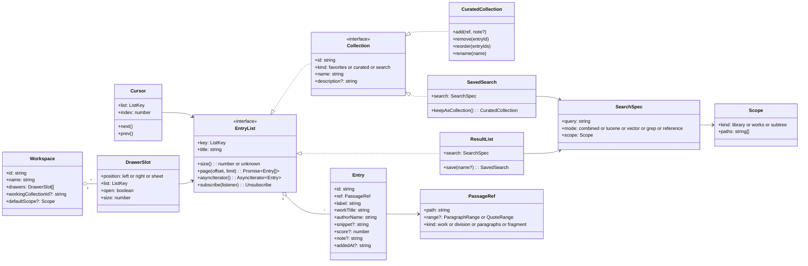

# Search and collections: specification

Status: **spec, ready for implementation in steps** (see
[Assessment and implementation plan](#assessment-and-implementation-plan) at the
end).

Goal: a reader can search the whole library or just the book in hand, keep
working through the results across page loads, park what matters in
collections with one tap, and arrange searches and collections beside the
reader. One vocabulary, one item model, and shared UI components cover all
of it.

## 1. What already exists

The spec builds on what is there; most of the data plumbing exists.

| Area | Today | Where |
|---|---|---|
| Search modes | `title`, `author`, `lucene`, `vector`, `grep`; a combined default (all indexed modes at once, tiered) | `SearchView.tsx`, `readerService.searchCombined` |
| Search scope | **None.** `/api/search/{lucene,vector,grep,divHeads}` take only `q` and `limit` | biblioteca-server `SearchRestController` |
| Saved searches | Name + query + mode + up to 100 hits. Account: server collections of kind `SEARCH`; anonymous: localStorage | `services/savedSearches.ts`, `POST /api/collections/mine/searches` |
| Curated collections + favorites | Items of type work/chapter/quote. **Stored inside the user-preferences JSON** (account or localStorage), not in the server's collection tables | `readerService.attachCollectionsStore`, `preferencesStore.ts` |
| Server collection model | `DivCollection` (kinds `FAVORITES`, `USER`, `SEARCH`) with ordered items of kind `DIV`, `FRAGMENT`, `SNIPPET`; CRUD, item add/remove, reorder (`PUT /mine/{id}/order`), authenticated REST reads | biblioteca-server `DivCollectionRestController`, `V10__Collections_with_uuid_ids` |
| Client filtering | Accent-folded, all-words matching shared by the collections screen and the TOC filter; keyboard row model | `services/collectionSearch.ts` |
| Generic types | `Collection<Entry>` with `PersonalCollection` and `SavedSearch` | `types/textbase.ts` |
| Similar | Selection/paragraph → vector search modal, paged, savable | `ReaderSimilarityDialog.tsx` |
| Shortcuts | `/` opens search, `s` opens the collections quick-find, ↑↓/PgUp/PgDn/Enter in the navbar dropdown | `Navbar.tsx`, `useCollectionsShortcut.ts` |
| Mobile sheets | Drag-to-dismiss and swipe hooks, a footnote bottom sheet; `motion` is already a dependency | `hooks/useDragToDismiss.ts`, `FootnoteSheet.tsx` |

Two consequences shape the plan:

1. **Book-scoped search needs server work.** It cannot be done by filtering
   client-side: a top-100 library-wide result list filtered to one book is
   usually empty or wrong.
2. **Collections are persisted two different ways.** Saved searches use the
   server collection tables; curated collections ride in the preferences
   blob. Unifying them on `/api/collections` comes first, because
   everything else (working collection, drawers, workspaces) refers to
   collections by id.

## 2. Vocabulary

One set of terms in code, UI and docs.

| Term | Meaning |
|---|---|
| **Passage** | Anything addressable in the library: a work, a division (chapter, subchapter), a paragraph range, or a quoted fragment. Identified by a stable path plus an optional range. |
| **Entry** | A passage *inside a list*, with list-specific data: label, snippet, score, note, when added. Every list holds entries. |
| **List** | An ordered, iterable sequence of entries. Every list is iterable. |
| **Collection** | A named, persisted list. Kinds: **Favorites** (one per reader), **Curated** (hand-made), **Saved search** (a frozen result snapshot plus its query). |
| **Search** | Query + mode + scope. Running it produces a **result list** (transient, server-paged). |
| **Last search** | The most recent search and its results, cursor included. Always kept, survives reloads, reopened by `/`. Not a collection until saved. |
| **Search history** | The recent searches (query + mode + scope, no results), for quick re-run. |
| **Working collection** | The curated collection that "Add" targets by default: the last one used, or one the reader pinned. |
| **Scope** | Where a search looks: the whole library, a set of works, or a division subtree. Defaults from context. |
| **Cursor** | The current position in a list: "result 7 of 120". Lets the reader step to the next or previous entry while reading. |
| **Drawer** | A collapsible panel beside the reader showing one list. |
| **Workspace** | A named arrangement: which list sits in which drawer, plus the working collection and the default scope. Stored with the account. |

**Searching vs filtering.** *Searching* asks the server, produces a new
result list and is recorded in history. *Filtering* narrows a list that is
already loaded (a collection, the TOC, the current results), runs in the
browser, and is not recorded. Both use the same input component, made
visually distinct: a magnifier with "Search the library…" / "Search in
*Biblia ortodoxă*…" versus a funnel with "Filter 37 entries…". The UI never
switches silently from one to the other.

**Last search vs working collection** (open question in the notes): these are
two roles, not one. The last search is where you *read from*; the working
collection is where you *put things*. Both can be shown in drawers at the
same time. A saved search is a snapshot and does not accept manual adds;
**Keep as collection** turns it into a curated collection when the reader
wants to curate it.

## 3. Data model

Design rules:

- **One entry shape.** `Entry` replaces both `CollectionItem` and
  `SavedSearchItem` in the UI layer. Adapters map server items
  (`DIV`/`FRAGMENT`/`SNIPPET`) and legacy local items onto it. Every list
  component renders `Entry`s, so a result list, a collection and a saved
  search look and behave the same.
- **Iterable, but paged.** `EntryList` is an `AsyncIterable<Entry>` (the "all
  collections are iterables" requirement), and the UI uses `page(offset,
  limit)` so long result lists can be virtualized and fetched lazily. `size()`
  may be unknown for open-ended server searches.
- **`ListKey`** (`collection:<uuid>`, `search:last`, `search:<uuid>`) is what
  cursors, drawers and workspaces store. They never hold list contents.
- **`PassageRef.path`** is the stable author/opus/division path the router
  and the quote API already use. Paragraph ranges reuse `paragraphLinks.ts`
  (`p3-p7`); fragments reuse the TEI dot addresses of the quote API.
- The package lives in `src/library/` (`types.ts`, `adapters/`,
  `lists/`, `cursor.ts`, `scope.ts`) with no React imports, like
  `googleOneTapAuth.ts`. React hooks (`useList`, `useCursor`,
  `useWorkingCollection`) are thin wrappers using `useSyncExternalStore`
  around the existing subscribe pattern, so no state library is needed.

## 4. Search behaviour

### 4.1 Entry point: the search panel (non-modal)

- `/` (and the navbar icon) opens **one search panel**: centered on screen
  when nothing else is going on, as a drawer when a workspace has one, and as
  a full-height sheet on phones.
- It is **not a blocking modal**: on desktop, choosing a result opens it in
  the reader while the panel keeps its query, results and cursor. Reopening
  (`/` again) shows the same state *hydrated*: highlight on the entry last
  opened, scroll position kept. On phones the sheet closes on open, and `/`
  or the search tab restores it the same way.
- Editing the query after looking at a result simply continues the search.
  Nothing is lost.
- Keyboard: ↑ ↓ PgUp PgDn Home End move the highlight, Enter opens, Esc
  closes the panel (state kept). While reading a result: `]` / `[` open the
  next / previous entry of the **active list** (the last search by default;
  the list in the focused drawer otherwise). These are new bindings: `n`/`p`
  would clash with the reader's typing guard and existing letter shortcuts.

### 4.2 Scope

- Default scope comes from context: **library** in the catalog, **the current
  work** in the work page and the reader. A scope chip row under the input
  shows it ("In: *Biblia ortodoxă* ✕"); ✕ widens to the library.
- **+ Add work** puts other works in scope (typeahead over titles). A
  collection can be used as a scope ("search within the works of collection
  X"), so curated collections double as reusable search perimeters, e.g.
  "my three Bibles".
- Scope is part of `SearchSpec`. It is recorded in history and saved with a
  saved search.
- Server: `scope=<path>` (repeatable) on `/api/search/lucene`, `/grep`,
  `/divHeads` and `/vector`, meaning "path equals or starts with one of
  these". Lucene: a prefix query on the indexed path field. Vector store:
  a payload or metadata filter on the path. Grep: restrict the scanned
  divisions.

### 4.3 Modes

Combined (default), Lucene, Vector (semantic), Grep, and **Reference**
(below). Title and author lookups stay as **navigation suggestions** in the
dropdown (open a work or author page). They are not recorded in history or
saved. History is for text searches.

### 4.4 Reference search (Bible and other numbered texts)

- Typing a reference such as `1 Samuel 17`, `1 Sam 21:6`, `1 Regi 21`,
  `Mt 12:3-4` or `Luc 6, 3-4` is detected by a reference parser. The
  **first result** is "Go to 1 Samuel 17 in *Biblia ortodoxă*" (the Bible in
  scope or currently open), followed by the same passage in the other Bibles
  of the library. Enter jumps there, highlighting the verse paragraphs.
- Book names depend on language **and tradition**: the Romanian Orthodox
  Bible calls 1–2 Samuel "1–2 Regi" (Septuagint naming), so "1 Regi 21:6" there
  is 1 Samuel 21:6 elsewhere, and Psalm numbers differ between Hebrew and
  Septuagint numbering. The parser yields canonical OSIS ids (`1Sam.21.6`);
  a **per-edition reference index** maps OSIS book/chapter/verse to that
  edition's division path and paragraph.
- That index cannot be derived from paths: division slugs come from headings
  (`…/cartea_intai_a_regilor/nasterea_lui_samuel`). Chapters are marked in
  heading text (`Capitolul 1.`, or `Chapitre 1`
  as a `div3` inside one `div2` per book in the French Bible). Verses are
  paragraphs starting with `1.` or `1 `. The index is built **server-side at
  import** with per-edition rules (book-heading → OSIS map, chapter-label
  regex, verse-prefix regex) and stored as a small table:
  `(work, osisBook, chapter, verse) → (divPath, paragraph)`.
- **Cite**: on a resolved reference or a verse selection, "Copy citation"
  gives `1 Sam 21:6 (Biblia ortodoxă)` with or without the text, plus the
  permanent quote URL.
- **Cross-references** for the "1 Sam 21:6 → Mt 12:3-4, Mk 2:25-26, Lk 6:3-4"
  use case: scoped Similar (vector search restricted to the New Testament of
  the open Bible) finds them semantically. A curated cross-reference dataset
  (OpenBible.info publishes a large one under a CC-BY licence; check the
  terms before use) would list them directly as a "Cross-references" entry
  in the selection toolbar.

### 4.5 History and last search

- Every executed text search records `SearchSpec + executedAt + resultCount`
  in **search history** (deduplicated by spec; most recent first; capped,
  e.g. 200). Shown under the empty search input; ↑ in an empty input recalls
  the previous query. Removable one by one; "Clear history".
- The **last search** stores its spec, the result pages fetched so far and its
  cursor. It survives reloads (IndexedDB via a tiny key-value wrapper;
  localStorage is too small for result pages) and is restored by `/`.
- Anonymous readers keep both in the browser. Signed-in readers: history is
  synced through the preferences store (small), and the last search stays
  per-device in the first version.

## 5. Collections

### 5.1 Adding: one tap

- The selection toolbar (where **Similar** lives) and the reader toolbar get
  **Add to ‹working collection›**: one tap adds the selection (as a
  fragment), the tapped paragraph range, or the current chapter. A chevron or
  long-press opens the chooser: recent collections first, filter-as-you-type,
  "New collection…" inline.
- The working collection is whatever was used last, unless pinned. It is
  shown in the button label so the target is never a surprise. A toast
  offers **Undo**.
- Search results get the same button on each row (replacing "Save Result").

### 5.2 Managing: the Collections page as a workspace manager

- One list of all collections (Favorites, Curated, Saved searches), with a
  search input at the top that **filters** by name, description and entry
  contents (the existing `buildCollectionsView` semantics).
- Inline create / rename / describe / delete; drag-and-drop and keyboard
  reorder of entries (server `PUT /mine/{id}/order` exists); move or copy
  entries between collections; per-entry note.
- Each collection offers **Open in drawer**, **Set as working collection**,
  **Search within its works** (scope) and, for saved searches, **Run again**
  and **Keep as collection**.
- The `s` quick-find (CollectionsModal) becomes a lightweight view of the
  same list component, not a second implementation.

## 6. Drawers and workspaces

- **Desktop:** the reader stays centered; a right drawer (and later a left
  one) hosts any list: the last search, a saved search, a curated
  collection. Drawers are resizable and collapsible to a thin rail, with
  their own filter input. A key toggles them (proposal: `\`), and they
  remember open/closed state and width.
- **Phone:** no side space, so drawers become one **bottom sheet** with snap
  points (peek / half / full) and tabs for the lists the workspace holds. The
  same list component renders inside. Principle: every desktop operation is
  possible on a phone, one drawer at a time.
- **Workspace:** the drawer arrangement plus the working collection and the
  default scope, stored with the account through the preferences store and
  switchable by name ("Bible study", "Hugo letters"). Version one has a single
  implicit workspace; named workspaces come later (step 8).
- Top and bottom drawers, tabs inside drawers, floating or detached panels:
  **not planned** (see the assessment).

## 7. Server work required

| Change | Needed by | Size |
|---|---|---|
| `scope` (path prefixes) on lucene, grep, divHeads, vector search | Step 4 | M: Lucene and grep straightforward; the vector store needs a path filter in the query |
| Curated collections and favorites served from `/api/collections` instead of the preferences blob, with a one-time migration of existing preference collections | Step 0 | M |
| `FRAGMENT` items carrying quote addresses and `DIV` items carrying paragraph ranges (fields exist: `fragmentStart`, `fragmentEnd`) | Step 3 | S |
| Search history in the preferences document (or its own small table if it grows) | Step 2 | S |
| Per-edition Bible reference index built at import | Step 7 | L |
| Workspace documents in the preferences store | Steps 6 and 8 | S |

## 8. Open-source building blocks

The stack today is React 19, Tailwind 4, `lucide-react` and `motion`, with no
component library. The guideline is to add a dependency only where it removes
a real, hard problem (accessibility, keyboard, virtualization, parsing), and
to keep everything else in-house.

| Need | Candidate | Verdict |
|---|---|---|
| Keyboard-navigable, accessible lists with typeahead, multi-select, drag-and-drop reorder and virtualization (results, collections, drawers) | [React Aria Components](https://react-spectrum.adobe.com/react-aria/components.html) `GridList` / `ListBox` + `Virtualizer` | **Adopt** for the shared `EntryListView` (step 5). Unstyled (works with Tailwind via data attributes); arrow/page/home/end keys, typeahead and DnD built in. Import only the components used, to limit bundle size. |
| Plain virtualization if React Aria is not adopted | [TanStack Virtual](https://tanstack.com/virtual) | Fallback: headless and small, but keyboard and accessibility stay ours. |
| Resizable, collapsible side drawers with persisted sizes | [react-resizable-panels](https://github.com/bvaughn/react-resizable-panels) | **Adopt** in step 6. Collapsible panels, imperative collapse/expand, layout persistence. Check the current major's API: older docs show `PanelGroup`/`autoSaveId`. |
| Full docking (tabs, floating groups, popouts, serialized layouts) | [dockview](https://dockview.dev/) | **Not now.** Zero-dependency and capable (layout `toJSON`/`fromJSON`, edge groups), but it brings IDE-style complexity a reading app does not need. Revisit only if readers ask for several lists at once in tabs. |
| Bottom sheet on phones | vaul (behind the shadcn Drawer) | **Prefer in-house**: the existing `useDragToDismiss` / `FootnoteSheet` + `motion` already cover drag and snap; vaul's maintenance status should be checked before depending on it. |
| Command-palette style quick switcher (collections, history, commands) | [cmdk](https://cmdk.paco.me/) | **Optional.** Good for a "jump to collection / re-run search" palette; the main search panel is server-driven and stateful, so it stays our own. |
| Bible reference parsing | [bible-passage-reference-parser](https://github.com/openbibleinfo/Bible-Passage-Reference-Parser) (MIT, TypeScript, ESM) | **Adopt** in step 7. About 50 languages, including Romanian, French, Finnish, German, Hungarian and Spanish (no Catalan); OSIS output; versification options and custom translations for the Septuagint naming. |
| Client-side fuzzy filtering | MiniSearch, FlexSearch, Orama | **Not needed yet**: `matchesSearch` (accent-folded, all words) handles collections and TOC sizes. Reconsider MiniSearch if typo tolerance is requested. |
| Persisting the last search's result pages | idb-keyval (or Dexie) | **Adopt idb-keyval** in step 1 (tiny); Dexie only if querying stored data becomes necessary. |
| Global state | Zustand, Jotai | **Not needed**: module stores + `useSyncExternalStore`, the pattern `savedSearches.ts` already uses. |

---

## Assessment and implementation plan

*This section is my (Claude's) critical reading of the requirements above, written for planning.*

### Usefulness vs effort

| Requirement | Usefulness | Effort | Comment |
|---|---|---|---|
| Last search persists and reopens hydrated with its cursor; next/previous result while reading | Very high | Low | Most of the "work through results for days" value, with almost no new infrastructure. Do it first. |
| Search history (text searches only) | High | Low | Cheap, and needed for quick re-runs. Exclude title/author lookups: they are navigation. |
| One-tap add to the working collection | Very high | Low–medium | Biggest friction reducer for curation; existing server item kinds cover fragments. |
| Unified entry model and list component | High (enables everything) | Medium | Pays off once two views share it; removes today's duplicated result, collection and saved-search rows. |
| Book-scoped search (default scope from context) | Very high | Medium, server side | Without it "search in this Bible" and "Similar in the New Testament" give poor results. |
| Collections page as a manager (inline edit, reorder, scope-from-collection) | High | Medium | Mostly UI on top of existing server endpoints. |
| Drawers (one side + phone sheet) | Medium–high | Medium–high | Valuable for long study sessions, but only after lists and the last search are solid; otherwise it is chrome around little content. |
| Bible reference jump and citation | High for the Bible corpus | High | The parser is off the shelf; the per-edition index over heading-derived paths is the real work, plus Septuagint vs Hebrew naming and numbering. |
| Cross-references (1 Sam 21:6 → Mt 12:3-4…) | High for Bible study | Medium once references exist | A dataset lookup is precise; scoped Similar is the generic fallback. |
| Named workspaces | Medium | Medium | Useful only once people keep several drawers; start with one implicit workspace. |
| Free docking, top/bottom drawers, floating panels | Low | High | IDE features; complexity for both users and code. Defer indefinitely. |

Critical points:

- **The search/filter distinction is fragile**, as the notes say. Resolve it
  through visible UI language (icon, placeholder, scope chip), not by
  guessing intent. A filter never hits the server; a search always does.
- **A saved search should not double as a curated collection.** Mixing
  frozen results and manual curation in one object makes "Run again"
  ambiguous (does it drop my additions?). An explicit **Keep as collection**
  avoids that.
- **Modal search is the root of the "I lose my search" problem.** A
  persistent, non-modal panel with a cursor fixes it more simply than
  multi-drawer layouts.
- **Persistence split.** Curated collections in the preferences blob must
  move to the server collection tables before working collections, drawers
  and workspaces reference them by id. Otherwise every later feature carries
  two code paths.
- **Bible references are their own project.** Plan it with real data checks
  per edition (Romanian Orthodox, French, Finnish…), not as a search-box
  tweak.

### Implementation steps, by increasing complexity

Each step ships on its own, with unit tests and an e2e flow.

**Step 0: groundwork (S/M, client + server).**
`src/library/` with `PassageRef`, `Entry`, `EntryList`, `ListKey` and
adapters for favorites, curated collections, saved searches and search
results. Move curated collections and favorites to `/api/collections` with a
one-time migration from the preferences blob (anonymous readers stay in
localStorage behind the same interface). No visible UI change.
*Done when:* every existing collections and search test passes against the
adapters, and a migrated account shows identical collections.

**Step 1: last search that never gets lost (S, client).**
The search panel becomes non-modal; the last search (spec, fetched pages,
cursor) is persisted in IndexedDB and restored by `/` with the highlight on
the last-opened entry; `]` / `[` step through the active list while reading.
*Done when:* search → open result 3 → reload → `/` shows the same results
with result 3 highlighted, and `]` opens result 4.

**Step 2: search history (S, client; sync via preferences).**
Record text searches (spec + count); show them under the empty input; ↑
recall; delete and clear.
*Done when:* a history entry re-runs with the same mode and scope.

**Step 3: working collection and one-tap add (M, client + small server).**
"Add to ‹collection›" in the selection toolbar, reader toolbar and result
rows; chooser with recent collections and inline create; Undo toast;
fragments and paragraph ranges stored as `FRAGMENT` / `DIV` items.
*Done when:* select text → one tap → the fragment is in the working
collection and opens at the exact passage.

**Step 4: scoped search (M, server first).**
`scope` on the four search endpoints; scope chips (default from context,
+ Add work, use a collection as scope); Similar uses the current scope and
offers "in the whole library".
*Done when:* searching "Samuel" inside *Biblia ortodoxă* returns only its
divisions; Similar from 1 Regi 21:6 scoped to the New Testament lists the
Gospel parallels near the top (verify on real data).

**Step 5: shared list component and Collections manager (M, client).**
`EntryListView` (React Aria `GridList` + virtualization) used by search
results, collections, saved searches and the quick-find; inline
create/rename/describe; reorder by drag and keyboard; move/copy between
collections; Keep as collection; Search within its works.
*Done when:* the same component renders all lists, the old duplicated row
code is gone, and keyboard-only reordering works.

**Step 6: drawers (M/L, client).**
Right drawer on desktop (react-resizable-panels, collapsible, size
remembered), bottom sheet with snap points and list tabs on phones;
"Open in drawer" from any list; the toggle key; persisted via preferences.
*Done when:* a saved search in the drawer can be stepped through with `]`
while the reader shows each passage, on desktop and on a phone.

**Step 7: Bible references, citations, cross-references (L, server + data + client).**
Reference parser in the search input (Reference mode); per-edition reference
index built at import (book map, chapter-label and verse-prefix rules per
edition, Septuagint vs Hebrew naming and Psalm numbering); "Go to" as the
first result across all Bibles; Copy citation with/without text;
cross-references from a licensed dataset in the selection toolbar.
*Done when:* "1 Samuel 17" opens chapter 17 in the open Bible, in Romanian,
French and Finnish, and "1 Regi 21:6" in the Romanian Bible offers Mt 12:3-4,
Mk 2:25-26 and Lk 6:3-4.

**Step 8: named workspaces and a left drawer (M).**
Workspace documents (drawers, working collection, default scope), switcher,
a second (left) drawer on wide screens.
*Done when:* switching from "Bible study" to "Hugo letters" restores each
workspace's drawers and working collection, on another device too.

**Deferred:** docking/tabs/floating panels (dockview), top and bottom
drawers, cross-device sync of the last search's results, fuzzy client
search.

### Open questions

1. Should the last search sync across devices for signed-in readers (it is
   per-device in this plan), or is history sync enough?
2. Which Bible editions are in the corpus, and which naming tradition should
   be the default for a reference typed with no Bible open?
3. Is a cross-reference dataset with CC-BY attribution acceptable?
4. `]` / `[` and `\` as new shortcuts: acceptable, or do you prefer others?
5. Should anonymous readers get drawers and workspaces too (local only), or
   are they a signed-in feature?
